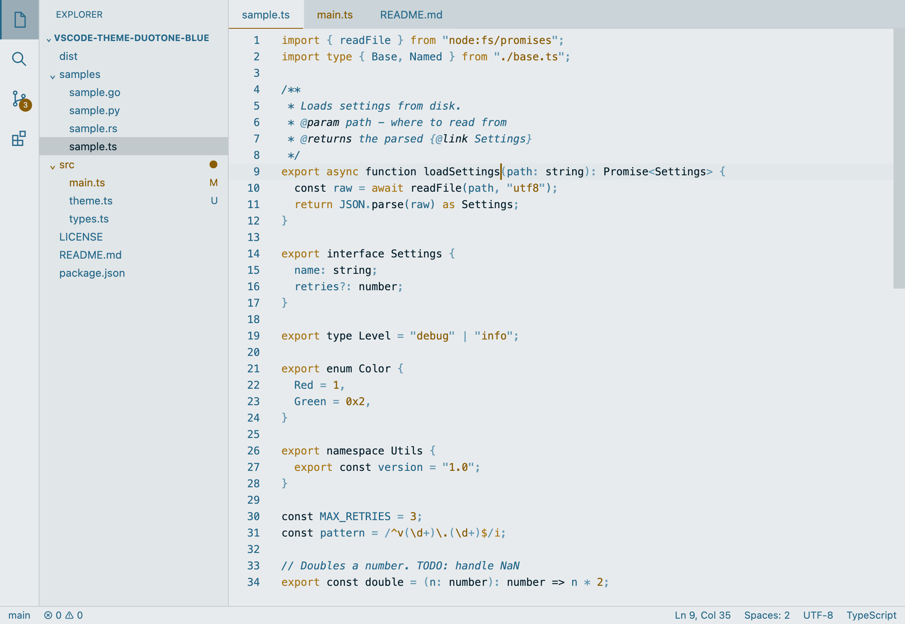
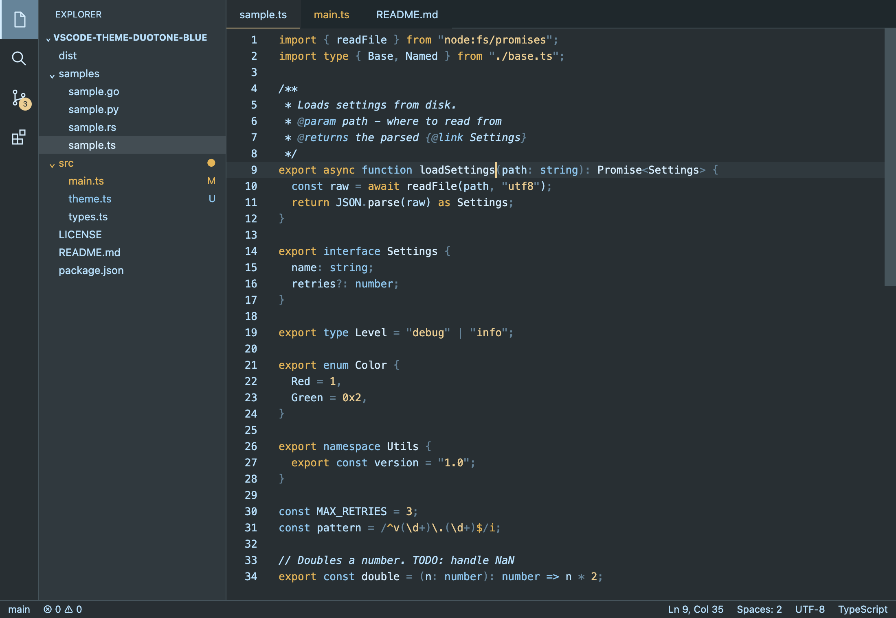

# DuoTone Blue

DuoTone Blue is a pair of Visual Studio Code themes built from two hues: blue
(Uno) and gold (Duo). The package contains **DuoTone Blue Light** and
**DuoTone Blue Dark**, with the UI palette generated independently from syntax
highlighting.

<table>
  <tr>
    <td><b>DuoTone Blue Light</b><br></td>
    <td><b>DuoTone Blue Dark</b><br></td>
  </tr>
</table>

## Color scheme

### Sources

- [DuoTone Light Blue Syntax](https://github.com/tsangkenneth/duotone-light-blue-syntax)
  provides the light palette.
- [DuoTone Blue Dark](https://github.com/smlombardi/duotone-blue-dark) provides
  the dark palette.
- [DuoTone Light Syntax](https://github.com/simurai/duotone-light-syntax) and
  [DuoTone Dark Syntax](https://github.com/simurai/duotone-dark-syntax) are the
  upstream two-hue syntax references.
- [Soy Themes](https://github.com/tsangkenneth/vscode-theme-soy) is the
  reference for the project structure.

### Syntax color mapping

The token scopes follow the baseline mapping in
[vscode-theme-gruvbox](https://github.com/jdinhify/vscode-theme-gruvbox), but
the colors come from DuoTone rather than Gruvbox's many unrelated accent hues.
The mapping keeps DuoTone's two-hue hierarchy:

| Scope family | Light | Dark |
| --- | --- | --- |
| Default text, comments | Uno-2 | Uno-2 |
| Strings and constants | Duo-1 | Duo-1 |
| Keywords and storage modifiers | Duo-1 | Duo-2 |
| Definitions, tags, selectors | Uno-1 | Uno-1 |
| Punctuation | Uno-3 | Uno-4 |
| Types and supported entities | Uno-1 | Uno-3 |

## Development

### Build

The generator uses Node.js directly and has no runtime or build dependencies.
Use Node.js 22.18 or newer, then run:

```sh
npm run build
```

The build generates `themes/duotone-blue-light.json` and
`themes/duotone-blue-dark.json`, and synchronizes the theme contributions in
`package.json`. `npm run check` rebuilds the files and validates their manifest,
syntax colors, and key contrast ratios. Package the extension with
`npm run package`.

### Testing in VS Code

Open this folder in VS Code and press **F5** (or choose **Run → Start
Debugging**). The `Launch Extension` configuration builds the themes first,
then opens an Extension Development Host with DuoTone Blue available. Use
**Preferences: Color Theme** in that new window to switch between the light and
dark variants. After changing a palette or the generator, press F5 again or
run **Developer: Reload Window** in the host window. The files in `samples/`
cover common languages, and **Developer: Inspect Editor Tokens and Scopes**
shows which rule colored a token.

### Previewing syntax colors in the terminal

`scripts/preview.ts` colors files with VS Code's own grammars and TextMate
engine, so you can check syntax rules without opening VS Code. It reads the
grammars from your VS Code installation, and uses the two development
dependencies in `package.json`, so run `npm install` first.

```sh
npm run preview                                    # all samples, light variant
npm run preview -- --variant duotone-blue-dark samples/sample.py
npm run preview -- --plain samples/sample.ts       # [text|role] markup
npm run preview -- --plain --scopes Settings samples/sample.ts
```

In a terminal it prints the code in the theme's colors. With `--plain`, or when
the output is piped, colored tokens are marked as `[text|role]` instead, and
`--scopes <text>` lists the TextMate scopes of matching tokens. Roles that share
a color are marked with the first of them in the palette, so constants show as
`string`. Semantic highlighting needs a language server, so the preview shows
TextMate colors only. If VS Code is installed somewhere unusual, pass its
built-in extensions folder with `--extensions <dir>`.

### Screenshots

`scripts/screenshots.ts` draws a simplified VS Code window for each variant,
using the theme's colors and the same tokenizer as the preview, and saves it to
`images/<variant>.png` with headless Chrome, Chromium or Edge. The window is an
approximation; the code colors are what VS Code shows without a language server.
Run `npm run screenshots` after changing colors, or pass `--variant <id>` for one
variant and `--chrome <path>` if the browser isn't found.

## License

[MIT](LICENSE)
